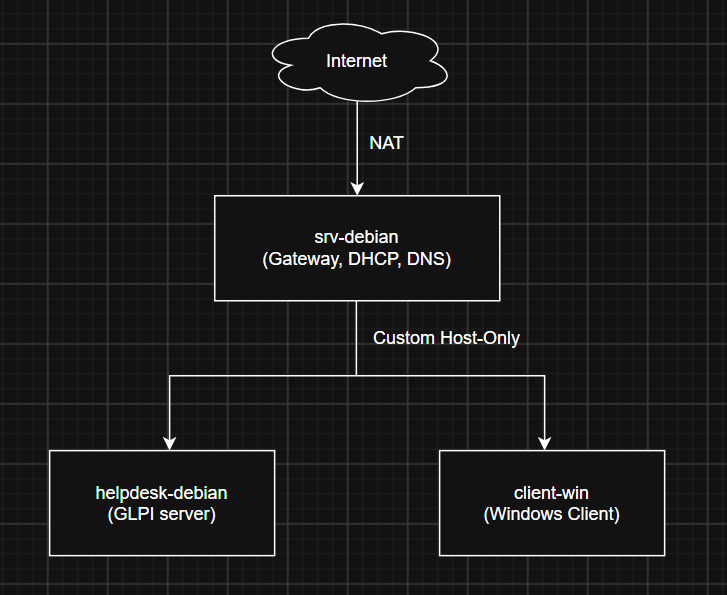

# Mini-IT-Helpdesk-Lab

Simulasi lingkungan kerja IT Service Desk (L1) di VMware Workstation: jaringan kantor kecil dengan DHCP, DNS, ticketing GLPI, dan kasus troubleshooting yang diselesaikan lewat ticket.

## Tujuan

Mempraktikkan alur kerja helpdesk L1 dari awal sampai akhir:

- Membangun jaringan dasar (IP, prefix, DHCP, DNS, NAT)
- Menjalankan sistem ticketing dan mencatat penanganan insiden
- Mendiagnosa masalah di Linux dan Windows
- Menulis dokumentasi (knowledge base) untuk user non-teknis
- Mengeskalasi kasus yang di luar kewenangan L1 ke L2

## Topologi



Debian server berperan sebagai "router mini" yang memberi DHCP, DNS, dan akses internet ke VM lain, seperti jaringan kantor kecil.

## Tabel VM dan IP

| VM | Peran | NIC | IP | Spek |
|---|---|---|---|---|
| srv-debian | Gateway + DHCP + DNS | NIC1: NAT (VMnet8), NIC2: Host-only (VMnet2) | NIC1 dari VMware, NIC2 statis `192.168.10.1/24` | 1 vCPU, 1 GB |
| helpdesk-debian | Server ticketing (GLPI/osTicket) | VMnet2 | Reservasi DHCP `192.168.10.10` | 2 vCPU, 2 GB |
| client-win | Windows client (user) | VMnet2 | DHCP dari srv-debian (`192.168.10.100-200`) | 2 vCPU, 4 GB |

- Domain lokal: `lab.local`
- Record DNS: `helpdesk.lab.local` mengarah ke `192.168.10.10`

## Teknologi

VMware Workstation, Debian, Windows 10/11, isc-dhcp-server, BIND9, nftables/iptables, Apache/Nginx, PHP, MariaDB, GLPI (atau osTicket).

## Langkah Singkat

### Fase 1: Bangun jaringan
1. Buat VMnet2 (Host-only, `192.168.10.0/24`) di Virtual Network Editor, matikan DHCP bawaan VMware.
2. Di `srv-debian`: set 2 NIC, IP statis NIC2, aktifkan `net.ipv4.ip_forward=1`, dan rule masquerade NIC2 ke NIC1.
3. Install `isc-dhcp-server` dan `bind9`, atur range DHCP, gateway, DNS, reservasi untuk helpdesk, dan zona `lab.local`.
4. Tes dari `client-win`: dapat IP otomatis, `ping 192.168.10.1`, `ping 8.8.8.8`, `nslookup helpdesk.lab.local`.

Bukti: `images/ipconfig-all.png`, `images/ip-a.png`

### Fase 2: Ticketing
1. Di `helpdesk-debian` install Apache/Nginx, PHP, MariaDB, lalu GLPI.
2. Akses dari client lewat `http://helpdesk.lab.local`.
3. Buat kategori (Network, Hardware, Account, Software), user, dan satu akun agent L1.

Bukti: `images/glpi-dashboard.png`, `images/glpi-kategori.png`

### Fase 3: Break and fix jadi ticket
Buat issue, lalu selesaikan sebagai L1 lewat ticket. Setiap ticket berisi: gejala, langkah cek, akar masalah, solusi, status.

### Fase 4: Dokumentasi
README ini, screenshot di folder `images/`, dan knowledge base di folder `kb/`.

## Daftar Kasus Troubleshooting

| # | Kasus | Akar masalah | Status |
|---|---|---|---|
| 1 | Client tidak dapat IP | Service DHCP mati | Selesai |
| 2 | Bisa ping IP tapi domain tidak resolve | Salah konfigurasi DNS | Selesai |
| 3 | Client tidak bisa internetan | `ip_forward` mati / rule NAT hilang | Selesai |
| 4 | Web ticketing tidak bisa dibuka | Apache mati / disk penuh | Selesai |
| 5 | User lupa password | Reset password akun Windows lokal | Selesai |

Detail tiap kasus (dengan screenshot sebelum dan sesudah): [`cases/`](cases/)

## Knowledge Base

Artikel singkat untuk user non-teknis ada di folder [`kb/`](kb/), misalnya:

- [`kb/reset-password-windows.md`](kb/reset-password-windows.md)
- [`kb/client-tidak-dapat-ip.md`](kb/client-tidak-dapat-ip.md)
- [`kb/cek-konektivitas-jaringan.md`](kb/cek-konektivitas-jaringan.md)

Template artikel:

```markdown
# Judul: Cara/Masalah (contoh: Komputer tidak bisa internetan)
Berlaku untuk: Windows 10/11
Gejala: ...
Langkah:
1. ...
2. ...
3. ...
Kalau masih gagal: buat ticket dan sertakan hasil langkah di atas.
```

## Masalah yang Ditemui dan Cara Fix-nya

| Masalah | Penyebab | Cara fix |
|---|---|---|
| (contoh) Client tidak dapat IP dari Debian | DHCP bawaan VMware di VMnet2 belum dimatikan | Matikan DHCP VMnet2 di Virtual Network Editor |
| ... | ... | ... |

## Catatan

- Menu GLPI dapat berbeda di beberapa versi; cari kata "Knowledge base" jika tidak ketemu.

## Struktur Repo

```
.
├── README.md
├── images/      # screenshot dan diagram
├── cases/       # detail kasus troubleshooting
└── kb/          # knowledge base (markdown)
```
